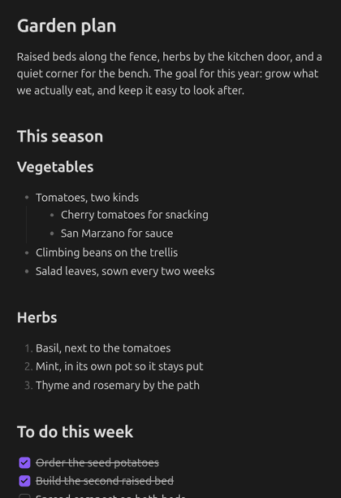
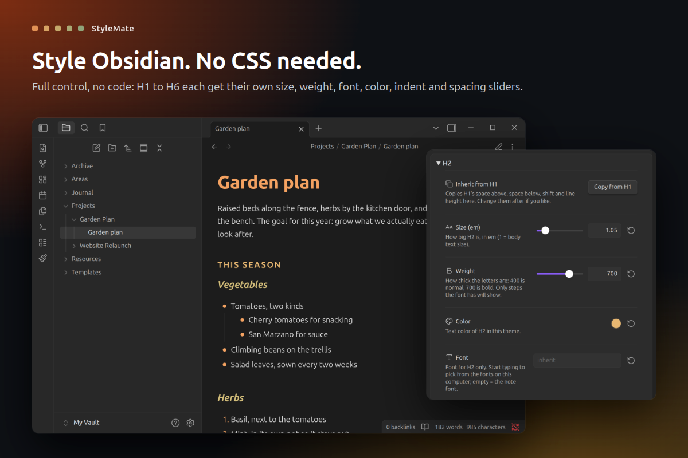
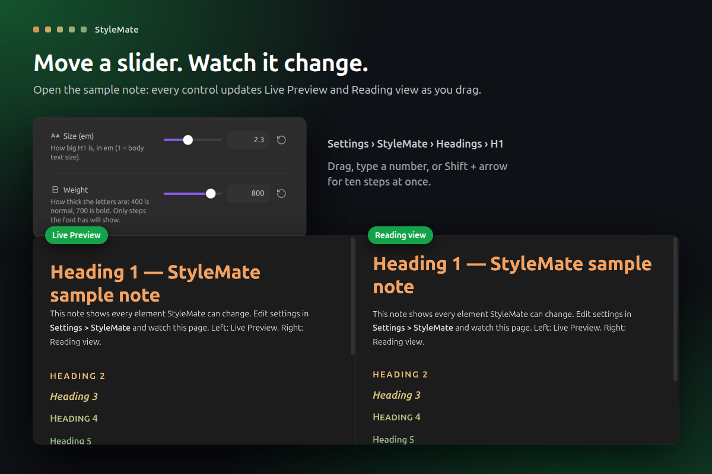
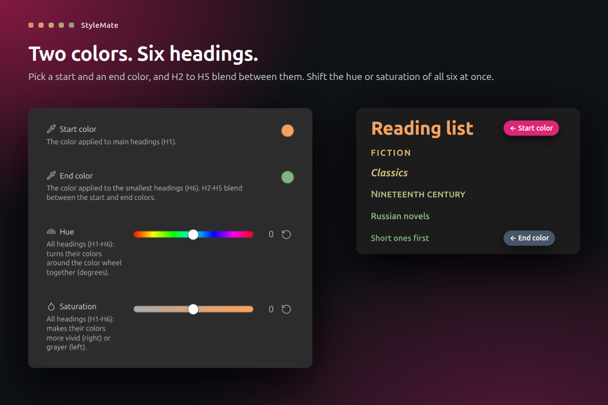
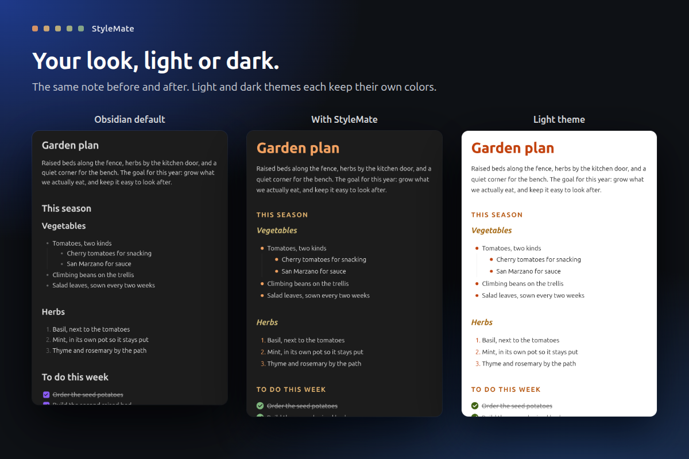
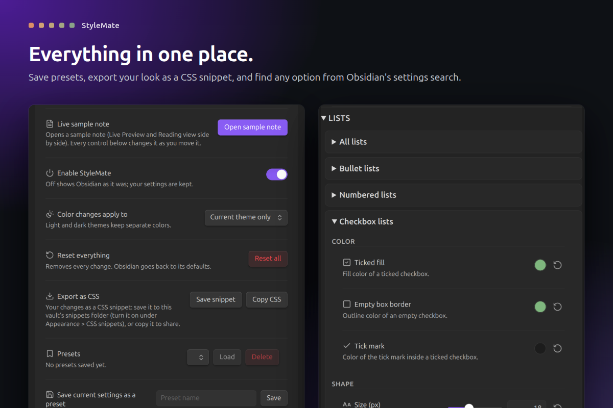

# StyleMate

**Full control over how your notes look. No CSS needed.**

Changing Obsidian's look usually means writing CSS snippets and reloading to see what happened. StyleMate turns every part of a note into a setting you can see: headings, text, lists, checkboxes, quotes and callouts, each with its own sliders and color pickers. Move a slider, watch the note change, done.

## What it does

- **Every heading, its own style.** H1 to H6 each get sliders for size, weight, line height, letter spacing, space above and below, and a left/right indent, plus their own font, color, letter case, italic and underline.
- **See it live.** A sample note opens in Live Preview and Reading view side by side, and changes as you drag.
- **Exact when you need it.** Every slider has a number box beside it. Type a value, or press Shift + arrow to jump ten steps.
- **Two colors, six headings.** Pick a start and an end color and H2 to H5 blend between them. Shift the hue, saturation, brightness or contrast of all six at once.
- **Lists your way.** Bullet, numbered and checkbox lists each get their own indent per level, spacing and marker color; bullets and checkboxes also get size and roundness.
- **Text, quotes and callouts.** Note font, text size, line width, link and tag colors, quote bars, and callout background, title, icon and text colors.
- **Light and dark.** Each theme keeps its own colors.
- **Presets and snippets.** Save looks as presets, or export your look as a CSS snippet to share.
- **Searchable settings.** Obsidian's settings search finds any StyleMate option.

## How to use

1. Install StyleMate from **Settings > Community plugins** and enable it.
2. Open **Settings > StyleMate** and press **Open sample note**.
3. Open a group (Page, Text & links, Headings, Lists, Quotes & rules, Editor) and move any slider. Every row has a reset arrow, and **Reset all** puts Obsidian back as it was.
4. To keep a look, save it as a preset or press **Save snippet**.

StyleMate sits on top of your theme. If a theme or snippet styles the same thing, StyleMate's setting wins while it is on.

## Privacy and safety

- **Your notes never change.** Your settings live in the plugin's own `data.json`. The sample note is the only file StyleMate creates, plus a snippet file when you ask for one.
- **No network, no telemetry.** It also has no runtime dependencies.
- **Easy to undo.** Turn StyleMate off and Obsidian looks exactly as before.
- **Desktop only.** Needs Obsidian 1.13 or later.
- **Signed releases.** Every release is built by GitHub Actions from this repository and carries a [build provenance attestation](https://docs.github.com/en/actions/security-for-github-actions/using-artifact-attestations).

## Support

If StyleMate makes your notes a little nicer to look at, you can [buy me a coffee](https://buymeacoffee.com/droidstreamer). Thank you!

## Develop

`npm ci`, `npm test`, `npm run lint`, `npm run build` (installs into `../test-vault`), `npm run obsidian:check` (live checks in a real Obsidian), `npm run showcase` (store screenshots), `npm run ship`.

MIT licensed. Made by Droid.
